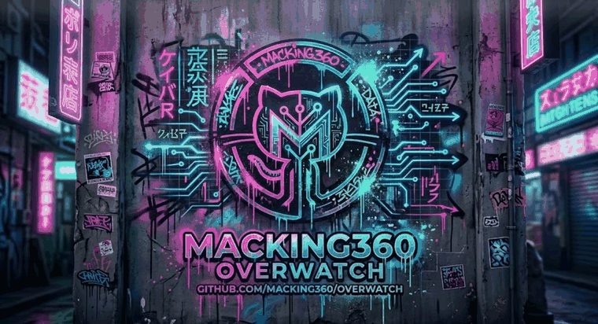

<p align="center">
  
</p>

# OverWatch — defensive host-integrity monitor

[](https://github.com/Macking360/overwatch/actions/workflows/ci.yml)

OverWatch watches the things attackers quietly change — **files**, **running
processes**, and the **registry autorun keys** that make programs start at boot
— and records every change to a local, timestamped activity log. It runs on a
single machine or across a fleet of enrolled **BYOD** devices that stream their
events to one central server.

It is **read-only** with respect to the host. It detects and records; it never
hides files or processes, and never writes to the registry. It began as a defensive rewrite of a single-file monitoring prototype and
grew into a small platform.

## An open question for full-stack enterprise development

A modern enterprise request is an act of accumulated trust. It crosses a
browser, an edge, a load balancer, a dozen services, a message bus, a database,
and a fleet of machines — and at almost every hop that trust is *assumed*, never
*proven*. We verify identity at the door and then spend the rest of the request
believing that nothing underneath us has quietly changed.

**So where, in your stack, should a system be made to prove it has not been
tampered with — and what would it cost to never ask?**

OverWatch is a small, honest attempt to answer that at the layer most people
stop watching: the host itself. But the more interesting question is where an
integrity conscience *belongs* in a full-stack system — a sidecar beside every
service, a gate in the CI/CD pipeline, a signed heartbeat in the control plane,
a fingerprint bound to every identity the moment it is created, a read-only
witness that can accuse but never act.

This repository is public and **built to be forked**. Clone it, bend it to your
architecture, and open the conversation: *in a system you would trust with a
business, what deserves to be watched — and who gets to verify the watcher?*

## What changed from the prototype

| Prototype | This suite |
|---|---|
| Hard-coded `auth_token` cookie (anyone could forge it) | Real Flask sessions + Werkzeug password hashing |
| "Attempting to hide file/process", registry "modification" | Read-only **detection** of file/process/registry changes |
| Hard-coded Slack webhook | Opt-in webhook via `OVERWATCH_ALERT_WEBHOOK`, off by default |
| Single flat file, inline HTML | Package, Jinja templates, tests, CLI, Windows installers |
| No accounts/permissions | `admin` (read/write) and `viewer` (read-only) roles |
| Single host | BYOD network fleet: device enrollment + event ingest API |

## Install

```
python -m pip install -r requirements.txt
```

Requires Python 3.11+. `psutil` powers process monitoring; registry monitoring
uses the Windows-only `winreg` (no-op elsewhere).

## Run the server

```
python -m overwatch run
# or:  python run.py
# Windows:  pwsh -File scripts\start_overwatch.ps1 -Install
```

Open http://127.0.0.1:8771. The **first account you register is an admin**;
after that, admins create accounts from the Users page. `/help` explains the
tool and is readable before sign-in.

## Monitors (all read-only)

- **Files** — watch specific paths for create/modify/move/delete.
- **Processes** — snapshot + diff every `OVERWATCH_POLL_INTERVAL` seconds.
- **Registry autoruns** — HKLM/HKCU `Run` and `RunOnce` diffed vs. a baseline (Windows).

## BYOD network fleet

Run one OverWatch as the central server. Each other device enrolls as an agent
and forwards its events:

```
python -m overwatch agent \
  --server http://SERVER_HOST:8771 \
  --enroll-key <from the Devices page> \
  --name "sales-laptop" \
  --watch-process --watch-registry \
  --watch-file "C:\Windows\System32\drivers\etc\hosts"
```

The agent enrolls once (sending a **device fingerprint**), caches its device
token under the instance dir, keeps a local log, and streams events to the
server. Revoke a device from the **Devices** page and its token stops working
immediately.

### Device fingerprinting

At enrollment the agent sends a read-only fingerprint — hostname, OS/platform,
architecture, CPU counts, total memory, boot time, primary MAC, and network
interfaces — stored against the device and viewable in the Devices console.

### Heartbeat + resilient forwarding

`--heartbeat N` (or `OVERWATCH_HEARTBEAT`) emits an "alive" event every N
seconds so a quiet device still proves it is reporting. The forwarder keeps a
bounded **retry buffer**: if the network drops, events queue (up to 2000) and
flush on the next event or heartbeat, so a transient outage never loses data.

### TLS / mTLS (user-designated certificates)

- **Server HTTPS:** set `OVERWATCH_TLS_CERT` + `OVERWATCH_TLS_KEY` (or `ssl_context`).
- **Agent trust:** `--ca-cert` / `OVERWATCH_CA_CERT` pins your own CA to verify the server.
- **Client mTLS:** `--client-cert` + `--client-key` present a client certificate.

### Ingest API

- `POST /api/enroll` — header `X-Enroll-Key`, body `{"name","platform","fingerprint"}` → `{"token"}`
- `POST /api/events` — header `Authorization: Bearer <device-token>`, body `{"events":[...]}`

### Health & log management

- `GET /healthz` — unauthenticated liveness + monitor status (for the scheduled task / fleet checks).
- `GET /events.csv` — export the activity log (signed-in users).
- `POST /events/clear` — clear the log (admin).

Browser POST forms are CSRF-protected (session token); the bearer-token ingest
API is exempt.

## CLI

```
python -m overwatch run                           # start the server/UI
python -m overwatch create-user NAME --role admin # create an account
python -m overwatch agent --server URL ...         # run as a BYOD agent
python -m overwatch status                         # show resolved config
```

Passwords come from the `OVERWATCH_PASSWORD` env var or an interactive prompt —
never from the command line.

## Configuration (environment)

| Var | Default | Meaning |
|---|---|---|
| `OVERWATCH_HOST` / `OVERWATCH_PORT` | `127.0.0.1` / `8771` | Bind address |
| `OVERWATCH_INSTANCE` | `instance` | DB, logs, keys |
| `OVERWATCH_DB` | `<instance>/overwatch.db` | SQLite path |
| `OVERWATCH_SECRET_KEY` | generated & persisted | Flask session key |
| `OVERWATCH_ENROLL_KEY` | generated & persisted | BYOD enrollment key |
| `OVERWATCH_ALERT_WEBHOOK` | *(empty = off)* | Webhook for warning/critical events |
| `OVERWATCH_POLL_INTERVAL` | `5` | Process/registry sweep seconds |
| `OVERWATCH_HEARTBEAT` | `0` | Heartbeat "alive" interval seconds (0 = off) |
| `OVERWATCH_OPEN_REGISTRATION` | off | Allow self-registration after first user |
| `OVERWATCH_TLS_CERT` / `OVERWATCH_TLS_KEY` | *(none)* | Serve the UI/API over HTTPS |
| `OVERWATCH_CA_CERT` | *(system trust)* | Agent: CA bundle to verify the server |
| `OVERWATCH_CLIENT_CERT` / `OVERWATCH_CLIENT_KEY` | *(none)* | Agent: client mTLS certificate |

Secrets (`secret_key`, `enroll_key`, `device_token`) and the database live in
the gitignored `instance/` directory.

## Windows service (scheduled task)

```
pwsh -File scripts\install_overwatch_task.ps1          # install (runs at logon)
pwsh -File scripts\install_overwatch_task.ps1 -Remove  # uninstall
```

Runs under the current user at the `Limited` run level — no elevation, no
SYSTEM, and it changes no security settings.

## Tests

```
python -m pytest
```
